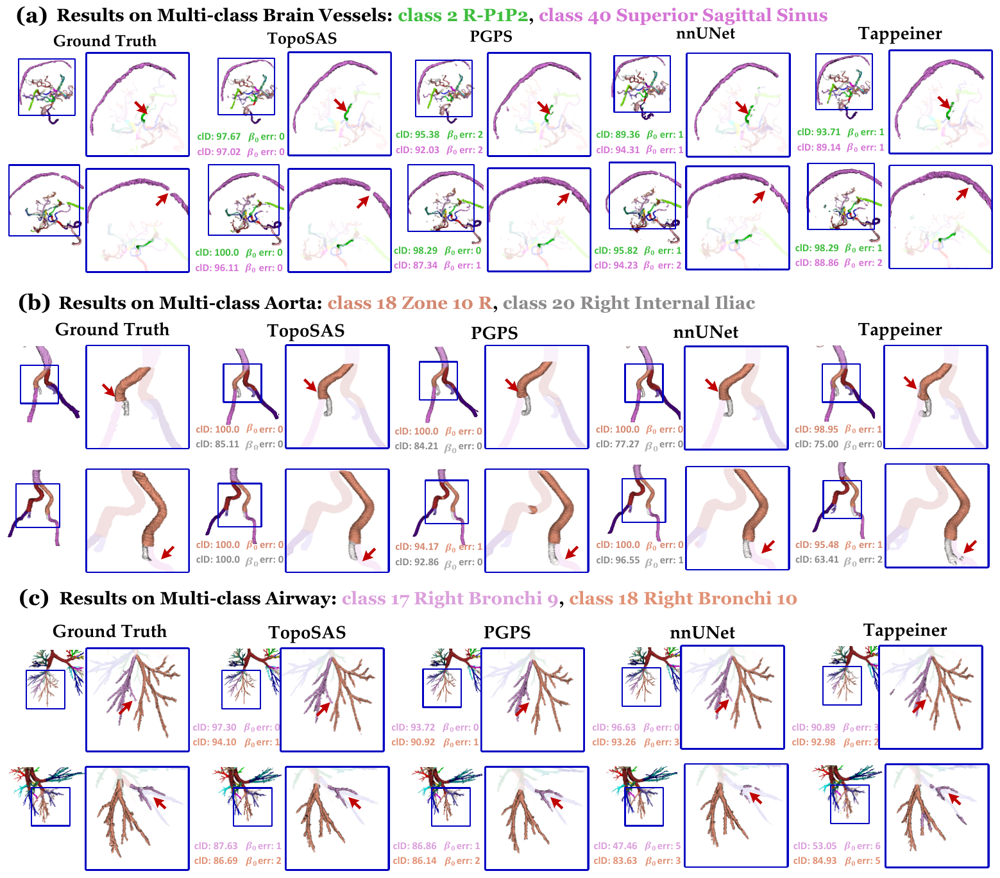

# TopoSAS: Shape-Aware Sampling for Multi-Class Tubular Structures

Official code for **TopoSAS**, the shape- and semantic-aware patch-size allocation strategy in *TopoSAS: Shape-aware Sampling Matters in the Modeling of Multi-Class Tubular Structures*.

This repository contains the method components and the reference evaluation code:

- **STCL** — a skeleton-free, directional Semantic Tubular Context Length measured directly on semantic label maps;
- **fixed-budget patch allocation** — the rule that turns STCL into an anisotropic patch while keeping the nominal voxel budget fixed;
- **reference evaluation** — Dice (class-average over `GT ∪ Pred`), binary-foreground clDice, and 26-connectivity β0 error.

It is a *planning* module: it changes only `patch_size`. Network architecture, spacing, preprocessing, loss, augmentation, optimizer, and inference stay those of the segmentation framework. The repository provides the patch planner, a thin nnU-Net plan-update/training wrapper, and the reference evaluation code; the training and inference implementation itself remains nnU-Net v2.

---

## Motivation

Under a fixed voxel budget, the patch dimensions determine the spatial context available to a 3D segmentation network. The default nnU-Net patch is initialized from the median resampled image shape and adjusted for network divisibility and the memory budget, so it follows the overall image extent rather than the axis-dependent context demand of the target anatomy. In multi-class tubular structures this matters: a patch that is too short along an elongated axis can hide thin minority branches and sever their class-wise connections, while enlarging all three axes isotropically is constrained by GPU memory.

TopoSAS keeps the nominal voxel budget `N³` and redistributes it across axes according to both the tubular shape and the spatial distribution of the anatomical classes. For example, the main comparison uses a `96×80×272` patch for AortaSeg24, a `160×80×160` patch for Airway-TNN, and a `160×160×80` patch for TopBrain25 at `N = 128` — all within the 5% volume window around `128³`.

## Installation

```bash
git clone https://github.com/EndoluminalSurgicalVision-IMR/TopoSAS.git
cd TopoSAS
pip install -e .            # STCL and patch planning
pip install -e ".[eval]"    # adds scipy and scikit-image for evaluation
```

Core dependencies: `numpy`, `nibabel`; evaluation extras: `scipy`, `scikit-image`; Python ≥ 3.9. For development (includes the evaluation dependencies):

```bash
pip install -e ".[dev]"
pytest -q
```

## Method

### 1. Semantic Tubular Context Length

For each physical axis `i ∈ {x, y, z}` (all lengths in millimetres), STCL is

$$
M_i = \frac{V \Delta_i}{R_i}, \qquad
\Sigma_i = \sqrt{\frac{1}{C}\sum_{c}\left(\mu_{c,i}-\bar\mu_i\right)^2}, \qquad
S_i = M_i + \frac{1}{3}\Sigma_i
$$

where `V` is the foreground voxel count, `Δ_i` the voxel spacing, `R_i` the number of foreground runs along axis `i`, `μ_{c,i}` the centroid of class `c`, `C` the set of present semantic classes, and the mean of the class centroids.

- `M_i` is a run-length-based **shape descriptor**: a mean physical run length that measures elongation along axis `i`.
- `Σ_i` is a class-aware **semantic descriptor**: the equal-class spread of class centroids, which measures how unevenly the classes are distributed along axis `i`.
- `S_i` combines the two in the same physical unit. The weight `t = 1/3` is fixed for all datasets and training objectives; no per-dataset tuning is involved.

Dataset-level values are the per-axis median of `M` and `Σ` over training cases, followed by `S = M + Σ/3`. Only training labels are used. STCL is measured in the physical space of the label maps; the patch step takes the resampled plan spacing as a separate input.

### 2. Fixed-budget patch allocation

Given a nominal cube edge `N`, spacing `Δ`, and STCL `S`, the physical volume budget and the theoretical voxel target are

$$
B_N = N^3\prod_i \Delta_i, \qquad
G = \left(\prod_i S_i\right)^{1/3}, \qquad
\tilde{p}_i = \frac{B_N^{1/3}}{\Delta_i}\cdot\frac{S_i}{G}.
$$

The continuous target is discretized on the stride-compatible lattice `p_i = m_i d_i`:

$$
\mathcal{P}_N = \left\lbrace p \in \mathbb{N}_+^3 \mid d_i \mid p_i, \quad \left|\frac{p_xp_yp_z}{N^3}-1\right| \le 0.05 \right\rbrace,
$$

and the selected patch minimizes the pairwise log-ratio objective

$$
(p_x^\ast,p_y^\ast,p_z^\ast) = \arg\min_{p\in\mathcal{P}_N} \sum_{i<j} \left[ \log\frac{p_i}{p_j} - \log\frac{\tilde{p}_i}{\tilde{p}_j} \right]^2.
$$

This objective is scale-free: it preserves the axis ratios of the theoretical target rather than its absolute size. Ties are broken by the volume error and then by multiplier order.

## Results

Mean over the nine dataset × loss combinations at `N = 128`, under three topology-oriented losses (clDice, cbDice, and CAL). Dice is the class average over `GT ∪ Pred`, clDice is binary/global, and `β₀ Err` is the per-class macro Betti-0 error.

| Methods | Dice ↑ | clDice ↑ | β₀ Err ↓ |
|---|---:|---:|---:|
| **TopoSAS** | **74.80** | **92.29** | **1.43** |
| nnU-Net (Isensee et al., 2021) | 73.56 | 91.74 | 1.55 |
| PGPS (Fischer et al., 2024) | 73.74 | 90.79 | 4.39 |
| Tappeiner et al. (2022) | 71.79 | 90.33 | 6.08 |



## Usage

### Released configurations

The published `N = 128` configurations are:

| Dataset | Plan spacing (mm) | Divisibility | STCL (mm) | Patch (x/y/z) |
|---|---|---|---|---|
| AortaSeg24 | 1.00000 / 1.00000 / 1.00000 | 16 / 16 / 16 | 29.15 / 28.29 / 85.25 | 96×80×272 |
| Airway-TNN | 0.78125 / 0.78125 / 0.50000 | 32 / 16 / 32 | 23.64 / 11.46 / 17.84 | 160×80×160 |
| TopBrain25 | 0.482422 / 0.482422 / 0.700012 | 32 / 32 / 16 | 9.39 / 11.10 / 10.31 | 160×160×80 |

`toposas reproduce` verifies these published `N = 128` patches. The `N = 96` and `N = 160` patches used in the budget sweep are not listed in the paper; `toposas patch --preset ... --budget 96 128 160` generates them with the same rule.

Data: [AortaSeg24](https://aortaseg24.grand-challenge.org/) and [TopBrain25](https://topbrain2025.grand-challenge.org/) are public; Airway-TNN is available upon request. Model weights will be released upon acceptance.

### Measure STCL from label maps

```bash
toposas stcl \
  --dataset airway=/path/to/Airway-TNN/labelsTr \
  --output stcl_report.json
```

The JSON report contains per-case `M`, `Σ`, `S`, and the dataset aggregate. NIfTI `.nii` and `.nii.gz` files are supported; background must be `0`.

### Compute a patch

Use a released preset:

```bash
toposas patch --preset airway-tnn --budget 128
# N=128: patch=(160, 80, 160) volume_ratio=0.9766 objective=...
```

Or pass STCL directly:

```bash
toposas patch \
  --stcl-mm 23.64 11.46 17.84 \
  --order xyz \
  --spacing-mm 0.78125 0.78125 0.5 \
  --divisibility 32 16 32 \
  --budget 96 128 160
```

`--order` is the physical x/y/z order of the patch tuple; `xyz` is the order used in the paper. If your plan stores axes in a different order, either reorder the inputs or use `--order` accordingly.

### Python API

```python
from toposas import aggregate_measurements, fit_patch, measure_nifti

cases = [measure_nifti(path) for path in sorted(label_dir.glob("*.nii.gz"))]
dataset = aggregate_measurements(cases)

allocation = fit_patch(
    dataset["stcl_xyz_mm"],
    order="xyz",
    spacing_plan_mm=(1.0, 1.0, 1.0),
    divisibility=(16, 16, 16),
    budget=128,
)
print(allocation.patch)          # (96, 80, 272) for AortaSeg24
print(allocation.volume_ratio)   # within 5% of 1
```

### One-shot example on a label folder

```bash
python examples/plan_from_labels.py \
  --labels /path/to/labelsTr \
  --order xyz \
  --spacing-mm 0.78125 0.78125 0.5 \
  --divisibility 32 16 32 \
  --budgets 96 128 160
```

## Evaluation

```bash
pip install -e ".[eval]"

toposas evaluate \
  --pred-dir /path/to/predictions \
  --gt-dir /path/to/labelsTs \
  --labels 23 \
  --workers 4 \
  --output metrics.json
```

The evaluator matches prediction and ground-truth NIfTI files by filename stem and supports `.nii` and `.nii.gz` (validated with `scikit-image 0.24.0` and `scipy 1.13.1`). `--labels` is the number of foreground classes (23 for AortaSeg24, 19 for Airway-TNN, 40 for TopBrain25); if omitted, it is inferred from each case.

Metrics follow the paper convention:

- **Dice**: class-average over classes present in `GT ∪ Pred`; classes absent from both are excluded and a class present only in the prediction scores zero.
- **clDice**: binary foreground, 3-D Lee skeletons, computed over the union bounding box.
- **β0 Err**: per-class mean absolute difference between the numbers of 26-connected components in prediction and ground truth.

The JSON report contains the per-case metrics, per-class details, and dataset mean ± population standard deviation. NIfTI arrays are evaluated in the same z/y/x orientation as the reference scripts; Dice and β0 are orientation-invariant, while clDice uses 3-D Lee skeletons in that orientation. The evaluator reproduces the reported Table I cells, for example AortaSeg24 cbDice at `N=128`: `75.57 / 97.85 / 0.23`.

## Adapting to nnU-Net

TopoSAS changes only `patch_size`; everything else follows the nnU-Net plan. The training settings are otherwise unchanged from the paper (nnU-Net v2.6.4, PyTorch 2.5.1, fixed random seed, initial learning rate 0.01, up to 2000 epochs). Back up the plan, replace the `patch_size` of the configuration you will train, and use that configuration for training and inference:

```bash
cp $nnUNet_preprocessed/DatasetXXX/nnUNetPlans.json \
   $nnUNet_preprocessed/DatasetXXX/nnUNetPlans.baseline.json
```

For example, for AortaSeg24 at `N = 128`, the `3d_fullres` configuration becomes:

```json
"3d_fullres": {
  "patch_size": [96, 80, 272]
}
```

Then train and predict with the same configuration:

```bash
nnUNetv2_train DATASET_ID 3d_fullres 0 -tr nnUNetTrainer
nnUNetv2_predict -i INPUT -o OUTPUT -d DATASET_ID -c 3d_fullres -f 0
```

If the dataset has not been preprocessed yet, run the usual nnU-Net planning and preprocessing first. Existing preprocessed data can be reused when the spacing and `data_identifier` are unchanged; otherwise rerun `nnUNetv2_preprocess`.

For convenience, `scripts/train_with_patch.py` performs the plan update and launches training:

```bash
python scripts/train_with_patch.py \
  --dataset 39 \
  --config 3d_fullres \
  --patch-size 96 80 272 \
  --fold 0 \
  --trainer nnUNetTrainer \
  --dry-run
```

The script creates `nnUNetPlans.baseline.json`, writes the new `patch_size`, prints the training command, and starts `nnUNetv2_train` unless `--dry-run` is set.

Notes:

- `patch_size` is in the plan's axis order, not necessarily `(x, y, z)`. The released table is in `x, y, z` order; reorder it if your plan transposes axes.
- Keep the released divisibility factors `d` (or derive them from the network pooling depth) so that the patch remains compatible with the U-Net topology.
- Keep the same nominal voxel budget when comparing with a baseline (`N=96`, `128`, or `160`) so that the comparison isolates patch shape.
- If you want to keep the baseline plan side by side, copy the plans file under a new `plans_name` and pass it with `-p` to training and inference.

## Repository layout

```
toposas/
  stcl.py        # M, Σ, S measurement and dataset aggregation
  patch.py       # fixed-budget patch law and discretization
  presets.py     # released dataset presets and reproduction checks
  metrics.py     # Dice, binary clDice, 26-connectivity beta0
  evaluation.py  # directory-level evaluation and JSON report
  cli.py         # `toposas` command line
scripts/         # nnU-Net training wrapper
tests/           # unit tests, including metric and reproduction checks
examples/        # end-to-end label-folder example
assets/          # qualitative figure
```

## License

Apache-2.0. See [`LICENSE`](LICENSE).
